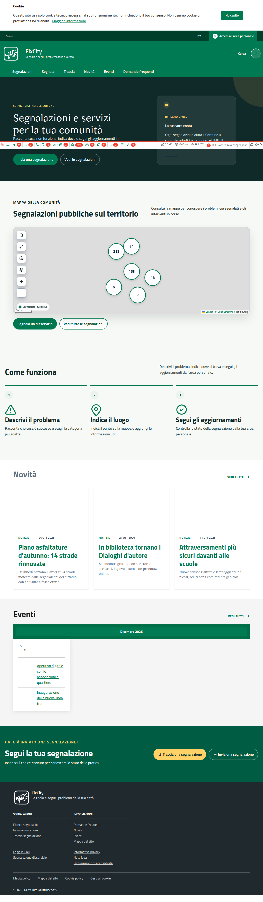

> Screenshot reale del front office FixCity, verificato il 23 novembre 2026. Per questo modulo è una superficie condivisa: il manuale non attribuisce al modulo una UI propria se non documentata dalle fonti.

# Manuale d'uso per attori

## Scopo

Blog gestisce articoli, categorie e contenuti editoriali. La pubblicazione e' rappresentata da `published_at`; il front office espone separatamente post ed eventi pubblicati, mentre il pannello Filament gestisce le risorse editoriali.

## Attori e capacita'

| Attore | Capacita' verificata | Verifica |
|---|---|---|
| Ospite | Puo' leggere gli elenchi e i dettagli front office verificati per post/eventi pubblicati. | [BlogFrontOfficeNovitaTest](../tests/Feature/BlogFrontOfficeNovitaTest.php#L79-L100); [BlogFrontOfficeEventsTest](../tests/Feature/BlogFrontOfficeEventsTest.php#L78-L90). |
| Utente normale autenticato | N/A verificato come autorizzazione editoriale. I test eseguono operazioni sul modello con un utente autenticato, ma non provano una policy Blog. | [ArticleWorkflowTest](../tests/Feature/ArticleWorkflowTest.php#L82-L108); nessuna policy Blog owner individuata. |
| Utente in gruppo/ruolo | N/A verificato: non e' stata individuata una matrice di ruoli/permessi Blog per gli articoli. | [AdminPanelProvider](../app/Providers/Filament/AdminPanelProvider.php#L11-L24). |
| Admin | Puo' accedere al pannello solo secondo l'autorizzazione comune Filament; capacita' editoriale specifica non verificata. | [AdminPanelProvider](../app/Providers/Filament/AdminPanelProvider.php#L11-L24). |
| Super-admin | N/A verificato come capacita' distinta: non e' presente una policy Blog che lo differenzi. | [README](README.md), [Article](../app/Models/Article.php). |
| Operatore/moderatore | N/A verificato. | Nessun ruolo editoriale o moderazione Blog dedicato trovato; la moderazione commenti appartiene a Comment. |

## Flussi principali

1. Un articolo viene creato o aggiornato come record `Article`.
2. Con `published_at` nullo resta una bozza; con una data entra nello scope `published()`.
3. Il front office filtra i contenuti per tipo: `/it/blog` per i post e `/it/events` per gli eventi.
4. Un articolo puo' ospitare commenti tramite `HasComments`; policy e moderazione del thread appartengono al modulo Comment.

## Prerequisiti

- Modulo Blog, modello `Article` e relativa persistenza disponibili.
- Per il pannello: autenticazione Filament e plugin translatable configurato.
- Per il front office: contenuto pubblicato, slug e integrazione Cms/tema che risolva il percorso.

## Limiti e casi non supportati

- L'autenticazione da sola non dimostra il diritto di creare, modificare, pubblicare o cancellare articoli.
- Un post non viene risolto nel ramo eventi e viceversa; i test verificano il filtro per tipo.
- Le rotte web del modulo sono vuote: la resa front office dipende dall'integrazione Cms/tema documentata nel README.
- Non e' verificato un workflow Blog per operatori, moderatori o ruoli applicativi.

## Riferimenti owner

- [README](README.md)
- [module structure](module.md)
- [Article](../app/Models/Article.php)
- [AdminPanelProvider](../app/Providers/Filament/AdminPanelProvider.php)
- [workflow articoli](../tests/Feature/ArticleWorkflowTest.php)
- [test front office post](../tests/Feature/BlogFrontOfficeNovitaTest.php)
- [test front office eventi](../tests/Feature/BlogFrontOfficeEventsTest.php)

